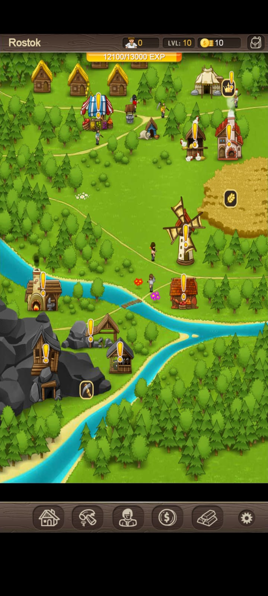

# Puzzle Craft for modern Android

<p align="center">
  
  &nbsp;&nbsp;
  
</p>

An unofficial compatibility patch for **Puzzle Craft 1.1.3**, published by Chillingo.

I remember playing this game years ago, and wanted to play it again recently. 
The game was released sometimes back in 2015, and has been delisted since from the play store.
Since installing the original APK on current Android versions doesn't work either,i made this repository which contains the decompiled game, a small set of patches that let it install and run on Android 14/15, and a ready-to-install APK.

> **Status:** the patched APK builds, is correctly signed, and has been
> checked statically, but it has been confirmed only on my Android
> 15 device and on waydroid. If you try it, please open an issue with 
> your device model, Android version and whether it worked.

## Download and install

Get `puzzle-craft-1.1.3-android15.apk` from the
[latest release](../../releases/latest).

### On Waydroid (Linux)

```sh
waydroid app install puzzle-craft-1.1.3-android15.apk
```

On an amd64 PC, Waydroid should use the game's bundled 32-bit x86 engine directly, without ARM translation. The game needs OpenGL ES 2.0. On hosts where Waydroid has no GPU acceleration (ex. NVIDIA users), enable Waydroid's software rendering.

## Device compatibility: 32-bit only

The game engine (`libhelloworld.so`, Cocos2d-x) only exists as **32-bit** builds: `armeabi` (32-bit ARM) and `x86` (32-bit Intel). 
The original source code isn't available, so this can't be recompiled for 64-bit.

- Phones and tablets whose CPU can still run 32-bit ARM apps can run the game.
- Devices that are **64-bit only** cannot run it at all. This includes the Google Pixel 7 and every later Pixel, and a growing number of other recent devices. On those, installation fails with *"App not installed as app isn't compatible with your phone"*.

To check a device with ADB:

```sh
adb shell getprop ro.product.cpu.abilist
```

If the output includes `armeabi-v7a` (or `x86` on an x86 device), the game can run 👍.

## What doesn't work

Mostly, online features since these depended on servers that have been shut down; no patch can bring them back:

- **In-app purchases:** The game uses Google Play's old AIDL billing API, which Google retired, so purchases can't be made.
- **Rewarded ads ("watch an ad for gold"):** Removed by this patch; see below.
- **Online extras:** Chillingo's cross-promotion offers and the links in the terms dialog point to services that no longer exist.
- **Resolution (in part):** On my device is somewhat stretched, and some touch-areas can be hard to accurately press. I didn't manage to fix this issue, so i'll leave it as is. It's enough for me that the game works *at all*.

The game itself, including saving progress, runs great.

### 1. Installable on Android 14/15

[`src/apktool.yml`](src/apktool.yml), [`src/AndroidManifest.xml`](src/AndroidManifest.xml)

| Change | Why |
|---|---|
| `targetSdkVersion` 21 → 24 | Android 15 blocks installing apps that target API < 24 (Android 14: < 23). 24 is the lowest value that passes. Staying this low keeps behaviour changes for the old code to a minimum. |
| `android:resizeableActivity="false"` | Apps targeting 24+ are resizable by default. This keeps the original full-screen behaviour for the game's OpenGL surface. I've had more issues with it being resizable during testing, so i set it to false |
| Removed a stray `>` text node inside `<application>` | Present in the original manifest. Android ignores it, but it's just something that i noticed. |

Raising the target to 24 was checked against the usual pitfalls. The game saves to its private app directory, so it doesn't need the storage permission. The native engine links only public NDK libraries and has no text relocations. The only uses of `MODE_WORLD_READABLE` (which throws for API 24+) are inside the ad SDK that change 2 disables.

### 2. Dead ad/analytics SDK disabled

[`src/smali/com/chillingo/puzzlecraft/android/ajagplay/PuzzleCraftFuseActivity.smali`](src/smali/com/chillingo/puzzlecraft/android/ajagplay/PuzzleCraftFuseActivity.smali)

All of the game's ad networks (AdColony, AppLovin, etc., mediated by 'Fuse Powered') start from a single call in `initializeAds()`. Their servers are gone (thank god), and their 2015-era code is the most likely thing to crash on a modern Android. In the game's Fuse wrapper class:

| Method | Now |
|---|---|
| `initializeAds()` | Does **not** call `FuseSDK.startSession()`. `mIsFuseActive` stays `false`, so the pause/resume/destroy hooks skip Fuse automatically. |
| `hasZoneReward()` | Always returns `false` (no rewarded ad available). |
| `showRewardAd()` | No-op. |
| `levelHasChanged()`, `goldValueHasChanged()` | No-ops. They only sent analytics to Fuse. |

The SDK classes are still in the APK, but nothing calls into them.

**Not changed:** the game engine, gameplay, assets, Crashlytics (its endpoints are dead so it just fails silently), the Chillingo terms dialog and the Google Play billing code (it also fails).

## Building 

Requirements: Java 11+, [apktool](https://apktool.org/) 2.10.0, and `zipalign` + `apksigner` from the Android SDK build-tools (or  [uber-apk-signer](https://github.com/patrickfav/uber-apk-signer), which bundles both).

```sh
# 1. Rebuild the APK from the decompiled source
apktool b src -o puzzle-craft-unsigned.apk

# 2. Align and sign with your own key
zipalign -p -f 4 puzzle-craft-unsigned.apk puzzle-craft-aligned.apk
apksigner sign --ks my-key.jks --out puzzle-craft.apk puzzle-craft-aligned.apk
```

The build is reproducible. Rebuilding `src/` with apktool 2.10.0 produces the same `classes*.dex`, manifest, resources, native libraries and assets as the release, byte for byte; only the signature differs.

## Verifying files

| File | SHA-256 |
|---|---|
| Original APK (`puzzle-craft-1-1-3-multi-android.apk`, versionCode 1132) | `396bb1001a72b5e079c7a194a32f9c083f54a814c8e627c19ea612900612322a` |
| Patched release (`puzzle-craft-1.1.3-android15.apk`) | `da2d80cc945cf5dbc7e37efd90315601fd3d27d75d4f9f15325cb4117f4bd7ea` |
| Release signing certificate | `751935ecaf00cf88e32be2ad63732a498d46cd2d83ad511accc8ac9b07ae4b18` |

Releases from this repository are signed with this certificate, so a later release installs as a normal update and keeps your progress. Check with `apksigner verify --print-certs <apk>`.

## Disclaimer

>This is an unofficial fan preservation project. It is not affiliated with, endorsed by or connected to Chillingo or the game's developers. 
>Puzzle Craft and all of its code, artwork, music and other assets belong to their respective owners. 
>Nothing here is offered for sale. If you are a rights holder and want this repository taken down, please open an issue.
